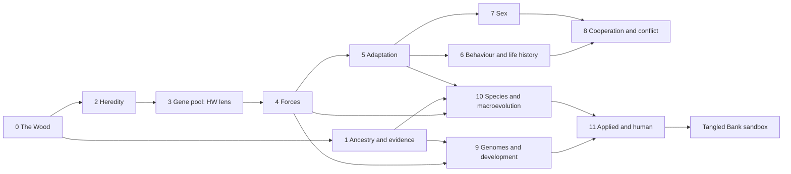

# R8: Curriculum coverage, misconceptions and teacher needs

*Reviewer role: university evolution lecturer and learning scientist. Method: I read `ui.js` PLAN, `ch99.js` and every chapter's intro, `real` and `maths` text (dumped from the running build via `window.TB.REG`), the Equilibrium level files (`lv_a`–`lv_d.js`) and Tangled Bank's `hunt.js` and `steward.js`. Science judgements build on R1–R7; where R7 corrects R1 or R3, I follow R7. Some text errors are being fixed in the current science sweeps (`docs/changes/`). Model and design problems are not, so they stay here.*

## Bottom line

1. Measured against a full undergraduate course (101 concepts in 15 strands), the three games cover **15 concepts well, 37 thinly and 24 with problems. They miss 25 entirely.** The missing ones are core exam material, not niche topics: mutation–selection balance, effective population size, F_ST, sex linkage, the fossil record, deep time, mass extinction, human evolution, the comparative method and horizontal gene transfer.
2. Hardy–Weinberg is taught twice (Equilibrium and The Census). So are drift, founder effects, selection against a recessive, the Commons, life history and sexual selection, each time in two games with different notation.
3. **The biggest misconception risk is a design choice.** Six chapters cast the player as an organism that *sets its own evolved trait*: gamete size, flower design, snake resistance, virus replication rate, finch beak, egg size. That rehearses the need-driven, intentional reasoning that research finds hardest to shift. The hunt chapters do the opposite ("Nobody decides"), and they are the designer's favourites.
4. Teachers cannot adopt the games yet. They lack level select, a projector layout, assignment and level toggles, data export, instructor notes, a pre/post test and keyboard access.
5. The learning layer (`ch99.js`) has excellent one-line principles. But its predictions and recall happen on cards *outside* play, are untracked, and rarely use distractors built from documented misconceptions.

---

## 1. The concept map

The map below is the union of four textbooks (Futuyma & Kirkpatrick, Barton et al., Herron & Freeman, Bergstrom & Dugatkin) and standard population and quantitative genetics, behavioural ecology, macroevolution, human evolution, evo-devo, genomics, applied evolution and nature of science. It is cross-checked against Vision and Change (AAAS 2011), the BioCore Guide (Brownell et al. 2014) and AP Biology Unit 7.

It has 15 strands:
- A: nature of science and evidence
- B: variation and inheritance
- C: population genetics
- D: selection and adaptation
- E: sex
- F: social evolution and genetic conflict
- G: behaviour and life history
- H: coevolution
- I: molecular evolution and genomics
- J: evo-devo
- K: speciation
- L: phylogeny and macroevolution
- M: human evolution
- N: applied evolution
- O: ecological context

Four **threshold concepts** decide whether students grasp the rest (Ross et al. 2010; Chi et al. 2012):
- variation matters;
- chance acts at every scale;
- scale, in numbers and in generations;
- emergence: populations change although no individual intends it.

The games handle the first and last of these well, but only in the hunt chapters.

## 2. Coverage matrix

**Key:**
- **W**, covered well: correct and playable, and the concept comes out of play.
- **T**, covered thinly: text, a quiz, or one sub-idea.
- **P**, covered with problems: a science error, a model that contradicts its own text, or a mechanic that teaches the wrong thing.
- **M**, missing.

EF is Endless Forms, Eq is Equilibrium and TB is Tangled Bank.

| Code | Concept | | Where; main issue |
|---|---|---|---|
| A1 | Null models, model assumptions | W | Eq L8 and L15, Census. "In this model" text exists for only 22 of 48 EF chapters, collapsed by default |
| A2 | Inference from samples (χ², likelihood, power) | W | Mendel (½¹⁰, χ²₃), Spindle L1, Census, Eq L17. Power never felt |
| A3 | Evidence: homology, fossils, observed change | T | Observed change only as cited text (Grants, Endler, Majerus) |
| A4 | Deep time, dating | M | |
| A5 | Competing hypotheses | P | Clinic "hit hard", Ewald's virulence hypothesis and the intermediate disturbance hypothesis are scored as settled |
| A6 | Experimental evolution | T | Many L1 (Ratcliff), TB Aripo. Lenski appears only in text |
| B1 | Mendelian transmission, dominance | W | Mendel L1–L2, Eq L1 |
| B2 | Sex linkage, multiple alleles | M | |
| B3 | Mutation: random with respect to need; DFE | P | The Scribe is a typing test where mutation is an error to avoid; no DFE. Eq L10 is inert |
| B4 | Recombination, linkage | W | Crossing Over, Mendel L2 |
| B5 | Genotype → phenotype, G×E | T | Eq lens is good. Shape-shifters' winning line has a flat reaction norm |
| B6 | Quantitative traits, R = h²S | W | Lichen Wood (S, R, realised h²). No G-matrix |
| B7 | Non-genetic inheritance | M | |
| C1 | Allele frequencies, Hardy–Weinberg | W | Eq L1–L8, Census (taught twice) |
| C2 | Drift | W | Drift Casino, Eq L12, Castaways L1 |
| C3 | Effective population size | M | |
| C4 | Founders, bottlenecks | P | Eq L13 teaches heterozygosity loss instead of allele loss; the castaway choice has no consequence |
| C5 | Gene flow, structure, F_ST, clines | T | Eq L11, Census Wahlund effect. No F_ST, no migration–selection balance |
| C6 | Inbreeding, non-random mating, F | P | Eq L14: "non-random mating never changes p" is false for disassortative mating; F never named |
| C7 | Selection with dominance; fixation ≈ 2s | P | Black Country is good. Eq L9's genotype lens lets the bird see genotypes. No Haldane's sieve, no Ns |
| C8 | Mutation–selection balance, load | M | |
| C9 | Balancing selection | T | Jaws, Census L2, Eq L17 sickle data. No malaria map |
| C10 | Coalescent | T | Guess, then watch. Comes *before* Drift Casino, although its bridge assumes drift |
| C11 | Linkage disequilibrium, hitchhiking | T | Crossing Over L3, Sweep, Two Fruits. LD never quantified |
| D1 | Variation + inheritance + differential reproduction | W | Lichen Wood, Black Country, Bitter Wings |
| D2 | Overproduction, limited resources | M | Hunts hold N constant (30 moths, 24 palewings), so the Malthusian premise (two CINS concepts) is invisible |
| D3 | Fitness = relative reproductive success | T | Brood and Raffle score descendants; hunts equate fitness with survival |
| D4 | Modes of selection | T | Sieve: the player draws the fitness function, which is the answer |
| D5 | Correlated response | T | Fancier L2 |
| D6 | Trade-offs, imperfect adaptation | T | Live Fast, Lock L2, Clinic. Never framed as "why adaptation is imperfect" |
| D7 | Landscapes, epistasis, contingency | P | Landscape: the player picks uphill steps with foresight |
| D8 | Testing adaptive hypotheses | M | |
| D9 | Artificial selection | T | Fancier (no tension), Crossing Over L3 |
| E1 | Why sex | P | Why Sex? switches the whole pond; no clone invading |
| E2 | Anisogamy, Bateman, operational sex ratio | P | Two Sizes is solved by holding "tiny". No Bateman, no OSR |
| E3 | Mate choice, runaway, handicap | P | The Lek's subtitle promises runaway; there is none. TB Aripo is better |
| E4 | Sperm competition | W | Raffle (add a remating caveat) |
| E5 | Sexual conflict | T | Raffle L2 |
| E6 | Sex allocation | P | Brood: linear payoff, scripted population, diploid ESS for haplodiploid figs |
| E7 | Sex determination | M | |
| E8 | Plant mating systems | M | The Meadow's subtitle promises fertilisation |
| F1 | Kin selection | P | Alarm Call reverses Sherman's call costs and ignores multiple paternity |
| F2 | Reciprocity | T | Blood Debts |
| F3 | Levels of selection, Price equation | P | EF Commons L2 teaches weak altruism as altruism. TB Commons is W |
| F4 | Parent–offspring conflict | P | Nest L1: eggs cost nothing. No imprinting |
| F5 | Eusociality | M | |
| F6 | Selfish elements, drive | W | Selfish Spindle, Copy and Paste L1 |
| F7 | Major transitions | P | Many Become One: cheater mutation rate 6% per division |
| G1 | Optimal foraging | W | Forager |
| G2 | ESS | P | Hawks: the player's choices never move the population |
| G3 | Ideal free distribution | T | Crowd: the player is a calculator outside the process |
| G4 | Signalling | T | Lek L2, Bitter Wings, Alarm Call |
| G5 | Life-history trade-offs | P | Live Fast: corner optima, imposed ageing. TB Slow Island is W |
| G6 | Senescence | T | Slow Island evolves it; theory never named |
| G7 | Plasticity, bet-hedging | P | Shape-shifters. Geometric mean computed, never shown |
| H1 | Crypsis, mimicry | W | Lichen Wood, Bitter Wings. No Müllerian mimicry |
| H2 | Red Queen | P | Lock L1 collapses to one host type; Why Sex? L2 conflates it with Fisher–Muller |
| H3 | Mutualism | T | Guest L1 is good; L2 is a quiz |
| H4 | Virulence | P | Pathogen contradicts itself on mosquitoes; the player sets virulence |
| H5 | Arms races, geographic mosaic | T | Lock L2 |
| I1 | Neutral theory | T | Clock, Coalescent |
| I2 | Molecular clock | P | Dates shuffled independently of species names (R7 M1) |
| I3 | Detecting selection | T | Sweep L1 is good. No dN/dS, no SFS |
| I4 | Duplication, transposons | T | Copy and Paste (two quizzes) |
| I5 | Horizontal gene transfer | M | Even the Clinic omits plasmids |
| I6 | Polygenic traits, GWAS | M | |
| I7 | Gene trees vs species trees | M | |
| J1 | Hox, colinearity | P | Switches: abd-A error (being fixed); colinearity never shown |
| J2 | Cis-regulatory evolution | T | Switches L2 |
| J3 | Deep homology, novelty | M | |
| K1 | Species concepts | P | Ring: warbler song gradient wrong (R7 M3) |
| K2 | Dobzhansky–Muller incompatibilities | W | River L1 |
| K3 | Geography of speciation | T | River, Two Fruits (a prediction quiz) |
| K4 | Reinforcement | T | River L2 |
| K5 | Polyploidy | W | Doubling |
| K6 | Hybridisation | M | |
| K7 | Ecological speciation | T | Two Fruits, Sieve's secret challenge |
| L1 | Reading trees | T | Tree Thinking L1: a quiz at chapter 45 of 48 |
| L2 | Building trees, homoplasy | P | Scores the convergent "lives in water" as uniting whale and hippo |
| L3 | Comparative method | M | |
| L4 | Fossil record | M | |
| L5 | Radiation, diversification | T | Archipelago: a radiation without radiating |
| L6 | Mass extinction | M | |
| L7 | Historical biogeography | M | |
| L8 | Origin of life | M | |
| M1 | Hominin record | M | |
| M2 | Out of Africa | M | |
| M3 | Archaic admixture | M | |
| M4 | Recent human adaptation | T | Lactase and EPAS1 in Sweep text; Eq L17 sickle-cell data |
| M5 | Human variation and "race" | M | |
| N1 | Antimicrobial resistance | W | Clinic. Fix the immune "mop-up", add horizontal gene transfer, hedge "hit hard" |
| N2 | Vaccines, pathogen evolution | T | Pathogen |
| N3 | Cancer | T | Many L2 text |
| N4 | Conservation genetics | T | Castaways L2 is good; Islands L2 is a quiz |
| N5 | Agriculture, gene drive | T | Crossing Over L3, Spindle L3 |
| N6 | Evolutionary medicine | M | |
| N7 | Human-driven evolution | T | Black Country only |
| O1 | Character displacement | T | Archipelago |
| O2 | Succession | P | Fire: oaks as fire-sensitive; intermediate disturbance hypothesis rewarded |
| O3 | Keystones, cascades | T | Food Web (invented removal data) |
| O4 | Island biogeography | T | Islands |

**By strand.** Most W ratings sit in the population-level core (B–D, F–H). Phylogeny, macroevolution and human evolution (L, M) contain 9 of the 25 M ratings and no W at all. A student who finished every chapter could not answer standard exam questions on F_ST, Ne, mutation–selection balance, fossils, mass extinction, comparative methods or human origins.

### Every game unit mapped

| Game section | Units → concepts |
|---|---|
| EF I Heredity | Mendel's Garden B1 B4 A2 · The Scribe B3 · Crossing Over B4 C11 D9 · The Census C1 C5 C6 C9 A1 · The Coalescent C10 I1 |
| EF II Chance | Drift Casino C2 · The Castaways C4 C5 C6 N4 · Why Sex? E1 H2 |
| EF III Selection | Lichen Wood D1 B6 H1 · Black Country D1 C7 N7 · Fancier D9 D5 · Sieve D4 K7 · Bitter Wings H1 G4 · Landscape D7 A6 |
| EF IV Games | Left Jaw, Right Jaw C9 G2 · Hawks and Doves G2 · Blood Debts F2 |
| EF V Sex | Fisher's Brood E6 · Two Sizes E2 · Lek E3 G4 · Raffle E4 E5 · Selfish Spindle F6 N5 A2 · Meadow H3 H5 |
| EF VI Families | Alarm Call F1 · Nest F4 · Commons F3 · Many Become One F7 N3 A6 |
| EF VII Lives | Live Fast G5 D6 · Forager G1 · Crowd G3 · Shape-shifters G7 B5 |
| EF VIII Coevolution | Lock and Key H2 H5 C9 · Clinic N1 D6 · Pathogen H4 N2 · Guest H3 |
| EF IX Genomes | Switches J1 J2 · Copy and Paste I4 F6 · Sweep I3 C11 M4 · Clock I2 I1 |
| EF X Species | River K2 K3 K4 · Two Fruits K3 K7 C11 · Ring K1 · Doubling K5 |
| EF XI Deep time | Archipelago O1 L5 · Tree Thinking L1 L2 · Food Web O3 · Islands O4 N4 · After the Fire O2 |
| Equilibrium | L1 B1 B5 · L2–L7 C1 · L8 C1 A1 · L9 C7 · L10 B3 · L11 C5 · L12 C2 · L13 C4 · L14 C6 · L15 A1 · L16 C1 · L17 A2 C9 M4 · Case Files C1–C6 |
| Tangled Bank | Lichen Wood, Black Country, Bitter Wings (as EF) · Streams of Aripo E3 A6 · Slow Island G5 G6 · Commons F3 |

Section XI, "Deep Time and Ecology", contains no deep time. Food Web and After the Fire contain no evolutionary process at all.

### Duplicates and overlaps

- **Hardy–Weinberg.** Equilibrium has the better derivation: the lens, the allele jars and the de Finetti triangle. The Census has the better detective mechanics: sampling cost, strata and a correct p-value. Merge them (R4) with one organism and one notation, and keep the triangle as a HUD widget.
- **Drift and founders.** Drift Casino, Eq L12, Eq L13 and Castaways L1 should become one unit.
- **Selection against a recessive.** Black Country with a gene-pool lens replaces Eq L9.
- **Inbreeding.** It appears in four places (Eq L14, Castaways L2, Census L2, Mendel selfing), and none names F consistently.
- **Hunt chapters ported twice.** Lichen Wood, Black Country and Bitter Wings exist in both TB and EF. TB's Black Country keeps the recurrent `mu: 0.01`.
- **Commons and life history.** TB Commons (live Price bars) beats EF's version. TB Slow Island evolves senescence, while Live Fast imposes it. Keep the TB models.
- **Sexual selection.** Lek and Aripo should become one campaign.
- **Red Queen.** Lock L1 and Why Sex? L2 currently invite confusion. Link them explicitly.
- **Islands.** There are five island settings with confusable names.
- **One mechanic, about 13 times.** "Set a slider, earn % of the best possible" (Brood, Two Sizes, Raffle, Lek, Meadow, Nest, Live Fast, Crowd, Lock, Pathogen, Archipelago, Fire, Guest). This duplicates a mechanic rather than a concept, and it is the main source of "boring".

## 3. Documented misconceptions

The sources are CINS (Anderson, Fisher & Norman 2002), ACORNS (Nehm et al. 2012), Bishop & Anderson (1990), Gregory (2009) and others as cited.

| # | Misconception (source) | Confronted now | Missed or reinforced | How a game could confront it |
|---|---|---|---|---|
| 1 | Organisms evolve because they need to (Bishop & Anderson 1990; Kelemen 2012) | Hunts ("Nobody decides"); TAKE.scribe | Reinforced by "set your own trait" chapters (see the next table) | Player as selective environment, never the evolving organism. An "explain it" question with a need-based distractor after each run |
| 2 | Acquired traits are inherited (Brumby 1984) | Nowhere | — | A "gym" level: trained individuals' offspring reset; only selection moves the mean. Include trait loss (cave-fish eyes), which triggers use/disuse thinking most (Nehm & Ha 2011) |
| 3 | Individuals transform, rather than proportions changing (Shtulman 2006) | Eq L2; hunt generations | No view follows an individual | Pin any moth: its colour stays fixed for life while the histogram shifts |
| 4 | Variation is noise (Shtulman 2006; Evans 2001) | Hunts | Sieve and most HUDs show means | Always draw distributions; a "no variation" switch stops selection dead |
| 5 | Mutations arise when needed (CINS) | Clinic and its TRANSFER card | Never tested | Luria–Delbrück fluctuation test and replica plating: jackpot plates show the mutants existed before the drug |
| 6 | Fitness means strength or long life (Gregory 2009) | Brood, Raffle | Hunts equate fitness with survival | A case where the long-lived type leaves fewer offspring (Slow Island, bright guppies) |
| 7 | Evolution is a ladder; trees read across tips (Gregory 2008; Baum et al. 2005; Meir et al. 2007) | Tree Thinking L1 | Comes at chapter 45, as a quiz | Early drag-to-rotate trees with node-counting traps |
| 8 | Everything is adaptive; drift is confused with gene flow (Andrews et al. 2012; Price et al. 2014) | Drift Casino, Eq L12 | Case Files give the answer in the prompt | "Adaptive or not?": replicate noisy traces, an evidence budget, the Ns rule |
| 9 | Selection acts for the good of the species (Gregory 2009) | Spindle | EF Commons L2 counts weak altruism as altruism | Zero self-benefit and explicit assortment; a lemming myth-buster |
| 10 | r is the share of all genes (Park 2007) | Alarm Call, RECALL rb > c | Identity by descent never explained | Pedigree path-counting with a "99% shared genes" trap |
| 11 | Dominant alleles spread; HW means no evolution (Masel 2012) | Eq L3, L15; Census fix | Drift in HW proportions never shown | A case where HW fits while selection acts (R4) |
| 12 | Bodies become resistant (WHO 2015 survey: 76%) | Clinic, TAKE.clinic | Patient and population blurred; no plasmids | Separate patient and population views; plasmids hop between beds |
| 13 | Species are fixed types; macroevolution is unobservable (Nadelson & Southerland 2010) | Ring, River, Doubling | No fossils; no scaling of micro to macro | A stratigraphy dig predicting where a transitional form lies (the logic that found *Tiktaalik*) |
| 14 | Deep time is incomprehensible (Catley & Novick 2009) | Nowhere | Clock is arithmetic | A logarithmic time zoom; generations converted to years in every run |
| 15 | High heritability means fixed (Visscher, Hill & Wray 2008) | Lichen Wood computes h² | h² never changes with the environment | A Fancier level where a better rearing environment lowers h² as the mean rises |
| 16 | Mutations are always harmful (Gregory 2009) | — | The Scribe frames every mutation as failure | A distribution-of-fitness-effects game: mostly neutral, some lethal, a rare winner |
| 17 | Models are reality (Lederman et al. 2002) | Three-kinds-of-truth panels | Collapsed and optional | "What does this model leave out?" answered before every reveal |

**Chapters that rehearse misconception 1.** In the six chapters below, the player is the evolving organism and dials its own heritable trait. The game rewards the very reasoning students already over-use.

| Chapter | The player… | Reframe as |
|---|---|---|
| Two Sizes | sets "your lineage's" gamete size | You set a *mutant's* size; watch it invade or fail |
| The Meadow | "designs flowers" | You are the pollinator community; flower variants rise or fall |
| Lock and Key L2 | sets snake resistance | You set newt toxicity; snake variants are selected |
| The Pathogen | sets virus replication | Strains compete across the warren |
| Archipelago L1 | sets the finch's beak | You set seed supply; beaks evolve |
| Live Fast L1–L2 | sets effort and egg size | Allocation alleles compete; you set mortality |

In the behavioural chapters (Forager, Crowd, Hawks, Alarm Call, Raffle, Brood), playing the animal is legitimate. Each still needs R2's "invasion view": a second act in which the player's rule becomes an allele in a visible population.

**Instruments to align with:**
- CINS
- CANS (Kalinowski et al. 2016)
- GeDI for drift
- MUM for macroevolution
- EvoDevoCI (Perez et al. 2013)
- ACORNS, machine-scored with EvoGrader (Moharreri et al. 2014)
- the Genetics Concept Assessment (Smith et al. 2008)

## 4. What professors need in order to adopt it

R6 covers the platform work (LTI, SCORM, privacy, WCAG). This section covers what a lecturer needs.

| Need | Now | Build |
|---|---|---|
| Syllabus alignment | None | Tag every level with a concept code (Section 2), textbook chapters, AP Unit 7, IB, A-level and the QAA benchmark. Searchable: "everything on drift" |
| 10–20 min activities | Chapters run 3–15 min; random RECALL cards interrupt every third opening | One card per unit: objective, clicker prediction, run, 3-minute pair talk, exit ticket |
| Projector mode | Phone-portrait column; low-alpha text; sound-led feedback | 16:9 layout, large high-contrast type, answers hidden; presenter controls for pause, step one generation, speed, seed, reveal and annotate |
| Assignable sequences, levels on/off | EF has no level select; Eq has only "unlock all" | Teacher builds a sequence (units, levels, order) shared by link or QR code; works as a single offline file |
| Custom parameters, sandbox | None | Expose N, s, h, h², μ, m, V/C, each labelled "realistic" or "×1000". Replicate runs side by side; the expected curve as a ghost behind the realised one. TB steward mode becomes the lecture sandbox, with shareable scenario codes |
| Pre/post assessment | None | A 25-item concept-tagged test from the inventories above, plus embedded items; per-concept normalised gain (Hake 1998) |
| Data export | None | CSV of predictions, wrong options chosen (a misconception report), time and stars per concept. Raw run trajectories for students to analyse in R or Excel |
| Discussion prompts | None | Three per unit, rising in Bloom level, one of them a model critique |
| Instructor notes | Scattered in `maths` and Notes | Equations, parameters, simplifications, star rules, known student errors, answer key, timing |
| "In nature" evidence | Good references, buried | A real-data panel per unit (peppered moths, Grant beaks, Allison 1954, Lenski). Designed versus real data marked on screen |
| Accessibility | No keyboard handling (`keydown`: 0); colour-only cues | Beyond R6: an untimed mode for reflex chapters (Lichen Wood, Jaws, Spindle L2); a shape channel for camouflage and mimicry; captions for sound cues |
| Stability | Content changes between builds | Version-pinned releases per academic year; changelog; a science-validation statement |
| Evidence it works | Untested with students | A two-course pilot (n ≈ 200): CINS and GeDI pre/post against a standard active-learning lab such as HHMI BioInteractive |

**Example lecture inserts (12–18 minutes each):**
1. **Drift Casino.** Every student runs a jar of 10 on a shared seed range, and the lines pool live into a fan, then a U-shaped histogram. Students first predict the share of jars that fix blue (it equals the starting frequency).
2. **Census, power.** Half the room samples 40 snails, half 4,000, from one mildly inbred population, then they compare p-values.
3. **Hawks and Doves tournament.** Students submit P(Hawk), and the class population evolves on screen toward V/C.
4. **Clinic ward.** Teams treat the same ward, and the class plots which policy bred resistance.

Prediction, peer discussion and immediate feedback are what the active-learning evidence rewards (Freeman et al. 2014).

## 5. Learning progression and restructure

**Sequencing bugs in the current order.**
- The Coalescent (chapter 5) precedes Drift Casino (6), yet its bridge says "Drift moves allele frequencies forward in time. Now run it backwards."
- Why Sex? sits in Chance, before selection.
- Census L2 diagnoses heterozygote advantage before the Selection section.
- Tree Thinking is chapter 45, although tree reading underlies speciation, the clock and every comparative claim. Herron & Freeman and Futuyma & Kirkpatrick teach phylogeny early.

**Prerequisite graph** (arrows point from prerequisite to dependent):

| Act | Keep or merge | Add |
|---|---|---|
| 0 The Wood (15-min hook) | Lichen Wood | Overproduction and carrying capacity (D2); pin-an-individual lens |
| 1 Ancestry and evidence | Tree Thinking, made interactive | Fossil dig (L4), homology, deep-time zoom (A4) |
| 2 Heredity | Mendel's Garden, Crossing Over, Scribe rebuilt around the DFE, Fancier | Luria–Delbrück, sex linkage, multiple alleles (B2) |
| 3 Gene pool | Eq L1–L7 compressed (R4's "Mixer"); Eq L8 + Census as one detective; Eq L16 | HW lens and triangle as a permanent HUD |
| 4 Forces | Black Country + Eq L9; Casino + Eq L12; Castaways + Eq L13; Eq L11, L14; Case Files with an evidence budget | Ne (C3), F_ST and clines (C5), mutation–selection balance (C8), 2s and Ns (C7), malaria (C9) |
| 5 Adaptation | Sieve (environment-driven), Landscape (stochastic, Lenski), Bitter Wings, Jaws, Hawks, Lock L2 | Testing adaptive hypotheses (D8), Müllerian mimicry |
| 6 Behaviour and life history | Forager, Crowd, Slow Island + Live Fast, Shape-shifters | Senescence theory named (G6) |
| 7 Sex | Why Sex? (invasion version, linked to Lock L1), Two Sizes, Lek + Aripo, Raffle, Brood (fig), Spindle | Bateman and OSR (E2), sex determination (E7) |
| 8 Cooperation and conflict | Alarm Call, Nest, Blood Debts, TB Commons, Many Become One, Guest | Eusociality (F5) |
| 9 Genomes and development | Clock, Coalescent (moved), Sweep, Copy and Paste, Switches | HGT (I5), GWAS (I6), gene trees vs species trees (I7) |
| 10 Species and macroevolution | Ring, River, Two Fruits, Doubling, Archipelago (a real radiation) | Hybridisation (K6), mass extinction (L6), diversification (L5), biogeography (L7) |
| 11 Applied and human | Clinic, Pathogen (strain competition, vaccines), Castaways L2, Islands L2, Spindle L3 | Out of Africa and admixture (M2–M3), human variation (M5), cancer, pest refuges, evolutionary medicine |
| Sandbox | TB steward mode as capstone and lecture tool | Scenario editor |

Food Web and After the Fire should leave the core path; at most they belong in an optional ecology appendix. That frees room for the missing evolution concepts. Different courses can take different routes through the acts:
- **First-year course:** Acts 0–5 and 10–11.
- **Population genetics module:** Acts 2–4 and 9.
- **Behavioural ecology module:** Acts 5–8.

## 6. The learning layer (`ch99.js`)

**What works.**
- The 48 TAKE lines are accurate principles, several aimed straight at misconceptions ("Antibiotics do not create resistance; they select it").
- The three kinds of truth (principle, model, nature) is the right structure for teaching the nature of science.
- The Lichen Wood prediction toast reports the player's own S, R and h².
- The Casino's four predict-before-bet cards target the croupier's misconceptions.
- Mendel's evidence notes teach likelihood well.
- The Sieve's secret challenge, where disruptive selection fails to split the flock, is a model of productive failure.

**What does not.**
- **Wrong place.** TRANSFER (6 chapters) and RECALL (24 of 48) are cards shown *before* play, so they add text before the first action and are never acted on. A prediction should be made inside the simulation (drag the line where p will go, tap the triangle), scored by distance and shown against the outcome.
- **No memory.** RECALL picks a completed chapter at random on every third chapter opening, with no record of errors and no spacing. The testing, spacing and interleaving evidence (Roediger & Karpicke 2006; Cepeda et al. 2006; Rohrer & Taylor 2007) needs a scheduler, such as a Leitner system on concept codes.
- **Recognition, not reasoning.** All items are three-option choices, and several distractors are implausible ("Mosquitoes prefer it", "It replicates less"). Build distractors from documented misconceptions, add confidence ratings, and add one short "explain why" per act, scored with ACORNS-style rubrics.
- **No new contexts.** Reasoning shifts with the organism (plant vs animal) and with gain vs loss of a trait (Nehm & Ha 2011). The items are almost all animal and trait-gain.
- **Gaps.** There are no RECALL items for 24 chapters, including the favourites Bitter Wings, Raffle and Forager. MODEL caveats are missing for 26 chapters, including Alarm Call, Nest, Raffle and Commons, which need them most.
- **Invisible to teachers.** Nothing is logged, so the misconception report that would sell the game to departments cannot exist.

**Recommendation.**
- Keep TAKE, BRIDGE and the three kinds of truth.
- Rebuild prediction as an in-simulation gesture.
- Rebuild recall as a spaced, misconception-coded, concept-tagged item bank. That one bank then provides the embedded assessment, the teacher dashboard and the pre/post test.

---

*References: Anderson, Fisher & Norman 2002 J Res Sci Teach 39:952 · Andrews et al. 2012 CBE-LSE 11:248 · Baum, Smith & Donovan 2005 Science 310:979 · Bishop & Anderson 1990 J Res Sci Teach 27:415 · Brownell et al. 2014 CBE-LSE 13:200 · Brumby 1984 Sci Educ 68:493 · Cepeda et al. 2006 Psychol Bull 132:354 · Chi et al. 2012 Cogn Sci 36:1 · Freeman et al. 2014 PNAS 111:8410 · Gregory 2008 Evo Edu Outreach 1:121; 2009 2:156 · Hake 1998 Am J Phys 66:64 · Kalinowski et al. 2016 CBE-LSE 15:ar64 · Masel 2012 BioEssays 34:701 · Meir et al. 2007 Am Biol Teach 69:71 · Moharreri, Ha & Nehm 2014 Evo Edu Outreach 7:15 · Nehm & Ha 2011 J Res Sci Teach 48:237 · Nehm et al. 2012 Am Biol Teach 74:92 · Park 2007 Evol Psychol 5:860 · Perez et al. 2013 CBE-LSE 12:665 · Price et al. 2014 CBE-LSE 13:65 · Roediger & Karpicke 2006 Psychol Sci 17:249 · Shtulman 2006 Cogn Psychol 52:170 · Smith, Wood & Knight 2008 CBE-LSE 7:422 · Visscher, Hill & Wray 2008 Nat Rev Genet 9:255.*
